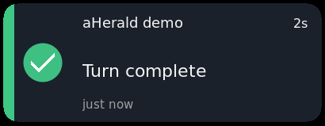
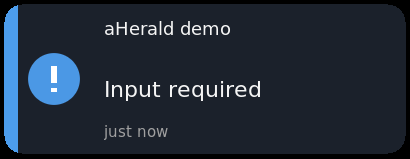
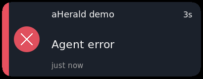
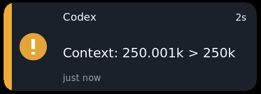

<div align="center">

# aHerald

**A native desktop notification companion for AI coding agents.**
Know the moment your agent finishes, fails, or needs you, without watching the terminal.

[](https://github.com/proprock/aHerald/actions/workflows/ci.yml)
[](https://github.com/proprock/aHerald/actions/workflows/nightly.yml)
[](https://github.com/proprock/aHerald/releases/latest)
[](LICENSE)


</div>

aHerald is a single portable native program (`aherald` / `aherald.exe`): no Electron, no web view, no
runtime to install. Agents call it from their hooks; it shows a small animated card, plays a sound,
and keeps a queue so nothing is lost while you are away.

## Features

- **[Codex](https://github.com/openai/codex) and [Claude Code](https://code.claude.com/docs)** through their hooks, plus **[OpenCode](https://opencode.ai), [Pi](https://pi.dev),
  [Goose](https://github.com/aaif-goose/goose) and [Crush](https://github.com/charmbracelet/crush)** through one
  generic input, `aherald --notify` ([other harnesses](docs/harnesses.md)).
- **Five signals:** turn complete, permission required, input required, error, interrupted. Waiting
  cards stay until you act; dismissing a card never answers the agent.
- **Resident mode:** one card with a priority queue (64 entries), `<` `>` navigation, event counter,
  and a native tray (pause, sound and pop-up switches, usage, edit config).
- **Pets and artwork:** builtin animations, Codex `pet.json` pets per harness (`[pets]`), or your own
  frames and WAV sounds. Everything is external and replaceable; missing files fall back to text.
- **Usage and warnings (opt-in):** Codex and Claude quota in the tray icon and a card, plus context-size
  and idle reminders per agent.
- **Messenger forwarding (opt-in):** send each new card to [Telegram](https://telegram.org),
  [ntfy](https://ntfy.sh), [Slack](https://slack.com), [Discord](https://discord.com) or any webhook, or run a
  command (mail, Signal, `ssh`, `say`), as well, so you hear about it away from the desk. Secrets come from environment variables, never from `config.toml`;
  a message holds only the event and the harness (the folder name only if you allow it), never a prompt
  or a path. The tray has an on/off switch ([configuration](docs/configuration.md#messenger-forwarding-ah-213)).
- **Agents in containers and VMs (opt-in):** an agent inside Docker, a VM or a sandbox cannot reach the
  local pipe, so aHerald can also take its turn-end and wait events over HTTP with a token
  (`[remote]`, off by default). The static `aherald-ping` binary (Linux, x86_64 and aarch64) sends only
  what aHerald reads: no tool input, prompt or full path. The shell sender and the plugin launcher post the
  whole hook payload over plain HTTP, including the command awaiting approval
  ([privacy](docs/privacy.md)). Recipes per environment: [sandboxes](docs/sandboxes.md).
- **Click to activate:** a click can bring the originating terminal or [Claude Desktop](https://claude.ai/download) session forward;
  on Windows, on macOS when you opt in, and on Linux X11 for one-session terminals, cards are
  suppressed while that session is focused (see [limits](#limits)).
- **Native everywhere:** Win32 on Windows 10/11 x64, AppKit on Apple Silicon macOS, and an X11/XWayland
  overlay with a StatusNotifierItem tray on Linux. Identical behaviour on all three.
- **Private by design:** no network listener unless you turn on `[remote]`, IPC limited to your user, payloads treated as untrusted
  and never logged, no tokens read except the two opt-in usage features. Everything aHerald reads or
  sends, and how to turn it off: [privacy](docs/privacy.md). See [limits](#-limits).

## Preview

These Linux screenshots show sample cards from the built-in demo. Context and idle warnings
are optional; the example warning uses a simulated context threshold.

| Turn complete | Input required |
| --- | --- |
|  |  |
| Agent error | Context warning |
|  |  |


## Install

| OS | Get it |
|---|---|
| **Windows** | Per-user setup EXE (Codex, Claude Code and OpenCode / Pi / Goose checkboxes) or the portable ZIP from [Releases](https://github.com/proprock/aHerald/releases/latest) |
| **macOS** (Apple Silicon) | `brew tap proprock/tap && brew install --cask aherald` ([Homebrew](https://brew.sh)), or the disk image (ad-hoc signed, see below) |
| **Linux** (x86-64, glibc) | `.deb` (`sudo apt install ./aherald-*.deb`) or the `.tar.gz` portable archive |

The macOS app is ad-hoc signed, not notarized, so Gatekeeper blocks its first start. Either open it once
and choose **Open Anyway** in System Settings, Privacy & Security (macOS 15 and later; right-click, Open no
longer works), or remove the quarantine mark yourself, which is quicker after `brew install`:

```sh
xattr -dr com.apple.quarantine /Applications/aHerald.app
```

Every release file carries a `.sha256` and a signed build-provenance attestation from the release
workflow. To check a download against it: `gh attestation verify <file> --repo proprock/aHerald` (GitHub CLI).

Then connect your agent. The program writes hook entries only when you ask, with a dry run first:

```sh
aherald --setup --harness claude --apply         # or codex
aherald --setup --harness opencode --harness pi   # bridge files for other harnesses (dry run without --apply)
```

Details: [installation and removal](docs/installation.md) · [portable guide](docs/portable.md) ·
[macOS](docs/portable-macos.md) · [Linux](docs/portable-linux.md) · [Claude Code plugin](docs/claude-hooks.md). Agents in containers and VMs: [sandboxes](docs/sandboxes.md).

Want the newest `master` before a release? The [nightly prerelease](https://github.com/proprock/aHerald/releases/tag/nightly)
is rebuilt every night when the checks pass; see [docs/nightly.md](docs/nightly.md) (unsigned, may break).

## Try it

```sh
aherald --demo                                   # loops through every signal
aherald --resident --event permission_required   # starts the resident and shows one card
aherald --status                                 # PID, queue, switches
aherald --quit
```

Settings live in `config.toml` beside the executable ([`config.example.toml`](config.example.toml) lists every
option; see [configuration](docs/configuration.md)). Nothing is installed or started automatically.

## Forward to a messenger

Opt-in and silent until you configure a sink. Keep the secret in your *user* environment (for example
`~/.config/environment.d/60-aherald.conf` on Linux, `setx` on Windows), never in `config.toml`:

```toml
[forward]
enabled = true

[[forward.sinks]]
type = "webhook"
include_folder = true     # optional: add the folder name, which then goes to the third party
include_host = true       # optional: add this computer's name (several computers, one chat)
url = "https://api.telegram.org/bot${AHERALD_TELEGRAM_TOKEN}/sendMessage"
content_type = "application/json"
body = '{"chat_id": "123456789", "text": "{text}"}'
```

A message reads `Claude: input required [my-project]`. The Telegram and ntfy examples, the
placeholders and the delivery rules are in [configuration](docs/configuration.md#messenger-forwarding-ah-213).

### Or run a command

For a service with a command line instead of an HTTP endpoint, a `command` sink runs a program for
each message. The array is the program and its arguments; no shell reads it, so a folder name with
spaces, quotes or `;` stays one argument and nothing runs. Typical uses:

- **Mail** with [msmtp](https://marlam.de/msmtp/) or [mutt](http://www.mutt.org), the body on standard input.
- **Signal** messages with [signal-cli](https://github.com/AsamK/signal-cli).
- **A pop-up on another machine:** `notify-send` over `ssh`.
- **A spoken alert** with `say` on macOS.

```toml
[[forward.sinks]]
type = "command"
kinds = ["permission_required", "input_required", "error"]
command = ["msmtp", "-t"]
stdin = "To: me@example.com\nSubject: aHerald\n\n{text}\n"
```

```toml
[[forward.sinks]]
type = "command"
command = ["say", "{text}"]       # macOS; one more sink beside the mail one, each has its own filter
```

A failing command, a missing program or one that runs over 10 seconds becomes one error card with
its exit status, never the program's output. Details, `${NAME}` secrets and the `ssh` caution:
[configuration](docs/configuration.md#command-sink).

## Support at a glance

| Harness | Mechanism | Signals |
|---|---|---|
| Codex | hooks (`--hook`) | complete, permission, interrupted, usage, warnings |
| Claude Code | hooks, status line, plugin | complete, permission, input, error, usage, warnings |
| OpenCode, Pi | bridge file (`--setup --harness`) | complete, error, interrupted, permission / prompts |
| Goose | hook file (`--setup --harness`) | complete |
| Crush | `crushrc` lines (manual) | complete, error, interrupted, permission |

Coverage and what was verified live per version: [harness compatibility](docs/harness-compatibility.md),
[Codex hooks](docs/codex-hooks.md).

## Limits

- Suppressing cards while you watch the originating session needs proof of the window and the session:
  a classic Windows console, Terminal.app or iTerm2 on macOS (opt-in), or xterm-like one-session terminals
  on a Linux X11 session. Tabbed terminals such as GNOME Terminal, tmux and Wayland sessions always deliver.
- Only sessions that report through a hook, bridge or `--notify` are visible; unrelated Codex CLI or app
  sessions are not observed.
- Native Wayland is not available (XWayland is used). On GNOME the tray needs an AppIndicator extension.
- macOS builds are ad-hoc signed, not notarized; Apple Silicon only.
- Mixed-DPI and multi-monitor setups have limited manual verification.

## Development

```sh
cargo fmt --all -- --check
cargo clippy --all-targets -- -D warnings
cargo test --all-targets
cargo build --release
```

Stable Rust; Windows builds use the MSVC toolchain. Tests run with plain `cargo test` (nextest was
measured and not adopted: [notes](docs/notes/ah-109-nextest.md)). The opt-in
[live harness checks](tests/live/README.md), [packaging scripts](docs/portable.md), the
[documentation index](docs/README.md), [contributor rules](AGENTS.md) and the [task list](TODO.md) cover
the rest. Release procedure: [RELEASE.md](RELEASE.md); release history:
[CHANGELOG](CHANGELOG.md).

## License

MIT, see [LICENSE](LICENSE). Sample artwork and sounds: [provenance](assets/README.md).
